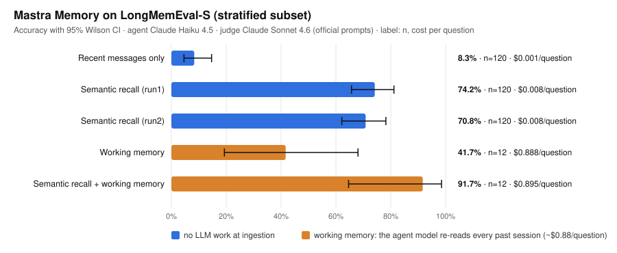

# Mastra Memory on LongMemEval-S

A small, reproducible benchmark of [Mastra](https://github.com/mastra-ai/mastra)'s `Memory` primitive (`@mastra/memory` 1.41.2, `@mastra/core` 1.84.0) on [LongMemEval](https://github.com/xiaowu0162/LongMemEval)-S, a public long-term memory benchmark. It compares four memory configurations on accuracy, token cost and latency. It also repeats the best configuration to measure run-to-run variance.



## Results

| Config | n | Accuracy (95% CI) | Memory build $/question | Answer $/question | Answer input tokens | p50 / p95 latency |
|---|---|---|---|---|---|---|
| Recent messages only | 120 | **8.3%** (4.6–14.7) | $0 | $0.0009 | 99 | 2.4s / 6.0s |
| Semantic recall, run 1 | 120 | **74.2%** (65.7–81.2) | $0 (local embeddings) | $0.0075 | 6,632 | 3.4s / 5.8s |
| Semantic recall, run 2 | 120 | **70.8%** (62.2–78.2) | $0 | $0.0075 | 6,632 | 2.5s / 8.6s |
| Working memory | 12 | **41.7%** (19.3–68.0) | $0.88 | $0.0057 | 4,835 | 5.1s / 9.0s |
| Semantic recall + working memory | 12 | **91.7%** (64.6–98.5) | $0.88 | $0.0122 | 11,376 | 4.0s / 10.0s |

On the 12 questions that every config answered: recent-only 0/12, semantic recall 9/12, working memory 5/12, combined 11/12.

Accuracy by question type, semantic recall (run 1 / run 2, out of 20 each): single-session user 18 / 18, single-session assistant 20 / 18, preference 13 / 10, multi-session 10 / 11, temporal reasoning 12 / 12, knowledge update 16 / 16. The full tables, including per-type results for every config, are in [`results/main/summary.md`](results/main/summary.md). Every answer, with the judge's verdict and token usage, is in [`results/main/answers.jsonl`](results/main/answers.jsonl).

Judge: Claude Sonnet 4.6 with the official LongMemEval prompts. Judging cost $0.001 per answer. Total spend recorded for the published results and the discarded attempts is **$15.39**. About $1 of further spend went unrecorded: early builds counted with Mastra's under-reported usage, and partial builds from stopped runs.

### In short

- **Semantic recall carries almost all of the accuracy, at almost no cost.** It reached 70.8–74.2% for under a cent per question, with no LLM work at ingestion.
- **Working memory on its own is weak and expensive.** It scored 41.7% (5/12), and building it cost about $0.88 and 15 minutes per question.
- **Adding working memory to semantic recall helped on 2 of 12 questions and hurt on none.** Both were counting questions ("how many doctor's appointments in March"). That is consistent with working memory keeping running tallies, but 2 versus 0 is not statistically significant (exact McNemar p = 0.5).
- **Run-to-run noise is about 4 points.** Re-answering the same 120 questions from identical retrieved context flipped 8 verdicts. Single-run differences of a few points on a sample this size are not meaningful.

## Comparing with Mastra's published numbers

Mastra has published two LongMemEval write-ups:

- [Semantic recall / RAG](https://mastra.ai/research/use-rag-for-agent-memory) (July 2025; gpt-4o; all 500 questions): topK 10 → 78.6%, topK 20 → 80.05%. Working memory alone → 35.4%, or 57.3% with per-question templates.
- [Observational Memory](https://mastra.ai/research/observational-memory) (February 2026): 84.23% with gpt-4o and 94.87% with gpt-5-mini.

This benchmark uses the same configuration values and question sampler as [Mastra's harness](https://github.com/mastra-ai/mastra/tree/main/explorations/longmemeval). It reproduces the pattern of their findings but not their exact numbers:

| | Mastra (gpt-4o, n=500) | This run (Haiku 4.5, n=120 / 12) |
|---|---|---|
| Semantic recall, topK 10 | 78.6% | 74.2% / 70.8% |
| — multi-session | 71.4% | 50–55% |
| — temporal reasoning | 69.9% | 60% |
| — knowledge update | 85.9% | 80% |
| — preference | 50.0% | 50–65% |
| — single-session user / assistant | 94.3% / 100% | 90% / 90–100% |
| Working memory alone (generic template) | 35.4% | 41.7% (CI 19–68) |

Run 1's confidence interval includes Mastra's 78.6%; run 2's falls just short. The biggest gap is on multi-session questions, which need facts gathered from several conversations. Likely causes, none of them isolated here:

- **Smaller embedder.** This run used Mastra's local default, bge-small-en-v1.5 (384 dimensions), which truncates text at 512 tokens. Mastra's published run used OpenAI `text-embedding-3-small`.
- **Different answering model and judge.** Haiku 4.5 instead of gpt-4o answered the questions, and Sonnet 4.6 instead of gpt-4o judged them.
- **Small subset.** Each question type has only 20 questions here.

Overall accuracy is the same pooled or task-averaged here, because every type has equal n. Mastra's "overall" figure is task-averaged.

## What I learned, and what I'd improve in Mastra memory

1. **`readOnly` on the `Memory` constructor does not stop `agent.generate()` from saving messages.** In `@mastra/core` 1.84.0, it only takes effect when passed per call: `memory: { options: { readOnly: true } }`. My first full run set it only on the constructor, so every answer was written back into the store. Later configs then retrieved earlier configs' answers. A probe showed the message count going 506 → 508 → 510 across two answers, and no change once the flag was passed per call. I discarded those answers (kept in [`results/main/discarded-attempts.answers.jsonl`](results/main/discarded-attempts.answers.jsonl)) and re-ran them. The harness now checks every answer: it fails if the store's message count or working memory changed. For an eval product, a memory that silently accepts writes is a contamination risk worth fixing, or at least warning about.

2. **The usage reported by `generate()` can be far below what the provider bills.** I wrapped the model to record usage from every provider request. Across 11 working-memory builds, Mastra's `totalUsage` reported 2.3× fewer input tokens than the provider meter (from 1.5× to 6.1× per question). One build was reported at 64,780 input tokens, but its past sessions alone total about 138,000 tokens, and every session has to be sent to the model at least once. The figures did match in a short two-step test, so I haven't found the cause. Concurrent agents and long tool loops are the main suspects. Cost views built on this number would under-count spend. That matters for trace intelligence, so it would be my first issue to dig into.

3. **Working memory is maintained through the agent's own tool loop, which makes it expensive to build.** Every past session went through the agent model, and some needed a second call after the update tool. That came to about 547k input and 67k output tokens per question: around $0.88 and 15 minutes on Haiku 4.5, roughly 120× the cost per question of semantic recall. Possible improvements:
   - extract memory in the background in batches, with a cheaper model (the approach Observational Memory takes);
   - prompt-cache the repeated prefix in the second tool-loop step.

4. **A full-replace update can wipe working memory.** On one preference question (`06f04340`), the working memory built from 50 sessions ended at 1,146 characters, describing only the final conversation (a D&D one-shot). Everything learned earlier was gone. Mastra's `vnext` working memory moves toward merge updates, but it isn't the default. Two possible guards:
   - make merge the default update mode;
   - reject writes that shrink the memory sharply without an explicit flag.

5. **Working memory is user-centric by design.** It went 0/2 on questions about what the assistant had said, and was most useful for running counts. This suggests positioning it as a complement to retrieval, not a replacement, which matches Mastra's own RAG write-up.

6. **Temperature 0 is not deterministic.** With identical retrieved context (input tokens matched on all 120 questions), none of the 120 answers was worded the same across the two runs, and 8 verdicts flipped. Repeat runs, or confidence intervals, belong in any memory leaderboard. Mastra's Observational Memory post reports only the latest run.

7. **Operational notes:**
   - libSQL's default vector index took about 105 MB for 514 vectors at 1024 dimensions, and about 55 MB per question at 384.
   - Titan embeddings and Haiku 4.5 were both heavily throttled on a default Bedrock quota. The harness disables SDK retries and retries in one back-off loop, so latency is timed on the successful attempt only.

## Setup

**Benchmark.** LongMemEval-S has 500 questions, each with its own chat history of about 50 sessions (around 115k tokens on average). There are six question types:
- single-session user, assistant and preference facts;
- multi-session reasoning;
- temporal reasoning;
- knowledge updates.

30 of the questions are abstention questions, where the correct answer is "I don't know".

**Subset.** Questions are picked with the same deterministic sampler as Mastra's own harness: sort by `question_id`, then take the first N of each type. No seed is involved and nothing is hand-picked.

| Configs | Questions | Why |
|---|---|---|
| All four | 12 (2 per type) | Working memory needs an LLM pass over every past session, about $0.88 per question |
| Recent-only, semantic recall | 120 (20 per type), semantic recall answered twice | These cost under a cent per question, so a larger sample and a variance check are affordable |

**Memory configurations.** The values are copied from Mastra's harness ([`explorations/longmemeval/src/config.ts`](https://github.com/mastra-ai/mastra/tree/main/explorations/longmemeval)):

| Config | `lastMessages` | Semantic recall | Working memory |
|---|---|---|---|
| Recent messages only | 10 | off | off |
| Semantic recall | 10 | `topK: 10, messageRange: 2, scope: 'resource'` | off |
| Working memory | 10 | off | `scope: 'resource'`, default template |
| Semantic recall + working memory | 10 | as above | as above |

As in Mastra's harness, every question is asked in a fresh thread for the question's resource. `lastMessages` is thread-scoped, so "recent messages only" sees none of the history: it is the no-memory floor. Its 8.3% comes almost entirely from abstention questions (8 of 9).

**Pipeline** (`src/`):

1. `ingest.ts` stores every past message with its original timestamp in libSQL and embeds it. For working-memory configs, it then replays each session, oldest first, through a Mastra agent with working memory on, as Mastra's harness does. The final working memory is copied into the question's store. Each question is ingested once, and every config answers from the same memory.
2. `answer.ts` asks `Current Date: …\nQuestion: …`, the official LongMemEval format, with memory set to read-only per call. It then verifies that the store is unchanged.
3. `judge.ts` grades each answer with the official LongMemEval judge prompts, verbatim, per question type and for abstention.
4. `meter.ts` records the token usage of every provider request, scoped per task with AsyncLocalStorage. Costs are computed from these counts, not from Mastra's reported usage.
5. `report.ts` writes `results/main/summary.md`, `summary.json` and `chart.svg`.

**Models.** Temperature is 0 and the same models are used for every config:

| Role | Model | Price per 1M tokens (in / out) |
|---|---|---|
| Agent: reads history, maintains working memory, answers | Claude Haiku 4.5 (Amazon Bedrock) | $1 / $5 |
| Judge | Claude Sonnet 4.6 (Amazon Bedrock) | $3 / $15 |
| Embeddings | `@mastra/fastembed` default, bge-small-en-v1.5 (384-d), local CPU | $0 |

Embeddings started on Amazon Titan v2, but the account's Titan quota throttled parallel ingestion (HTTP 429) to a crawl, so the runs switched to Mastra's local embedder. Answers from aborted attempts were discarded rather than mixed in: those made with Titan, those whose usage or latency was distorted by throttling, and those affected by the `readOnly` issue. They are kept in `results/main/discarded-attempts.answers.jsonl`, each with its reason. A working-memory build that still fails after retries aborts the question instead of skipping a session.

## Reproduce

Requirements:
- Node 22 or later;
- a Bedrock API key with access to Claude Haiku 4.5 and Claude Sonnet 4.6 in `us-east-1`;
- a Hugging Face token;
- a few GB of free disk.

```bash
cp .env.example .env   # add AWS_BEARER_TOKEN_BEDROCK (and HF_TOKEN if you aren't logged in with huggingface-cli)
./bench.sh             # about $13 and 3–4 hours on a default Bedrock quota; resumable
```

`bench.sh` downloads the dataset and checks it against the SHA-256 used here. It then runs all four configs on 12 questions, followed by recent-only and semantic recall (twice) on 120 questions. Each question's store is deleted after use, and the report is regenerated at the end. `--max-usd` (default 15) stops the run once the recorded spend in `results/main` reaches that amount.

## Limits

- **Small samples.** 12 questions are enough to show large effects and costs, not small accuracy differences. Every number comes with a 95% Wilson interval.
- **One judge model.** Sonnet 4.6 replaced gpt-4o. Its verdicts were spot-checked, not fully audited.
- **Shared working-memory build.** Working memory was built once per question and shared by both working-memory configs. Mastra's harness ingests the combined config separately, with semantic recall active during ingestion.
- **Default template only.** This run used the default working-memory template, not Mastra's `vnext` per-question templates.
- **Answering variance only.** The variance check repeats answering and judging on the same ingested memory; it does not re-run ingestion.
- **No prompt caching.** Working-memory cost is therefore an upper bound for a tuned setup.
- **Observational Memory not tested.** Mastra's current recommended memory system was left out to stay within budget.
